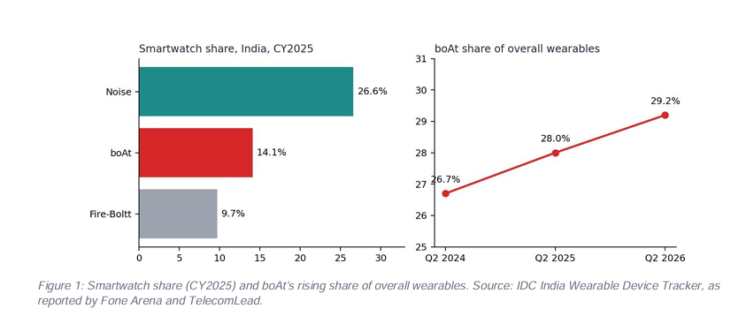
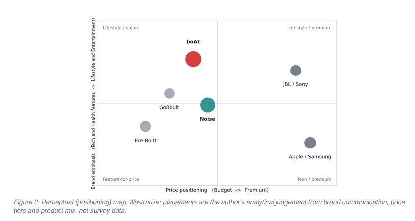
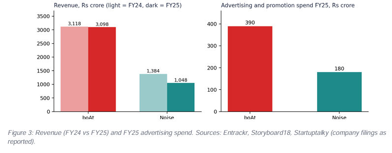

# Competitive Marketing Strategy & Positioning Analysis: boAt vs Noise

**Marketing Management Project**  
Secondary Research | STP Analysis | Marketing Mix (4Ps) | Branding & Strategic Recommendations

---

### Project Overview

This project presents a comprehensive comparative analysis of **boAt (Imagine Marketing)** and **Noise (Nexxbase Marketing)** — two of India’s leading homegrown consumer electronics brands in the wearables and audio market.

The study applies core Marketing Management frameworks to understand how two brands with similar origins (Gurugram, 2014–15) have followed different strategic paths and now dominate different segments of the market.

---

### Key Frameworks Used

- **STP Analysis** (Segmentation, Targeting, Positioning)
- **Marketing Mix (4Ps)** – Product, Price, Place, Promotion
- **Branding & Consumer Perception**
- **Strategic Recommendations**

---

### Key Insights

| Area                        | Winner     | Highlight                                      |
|----------------------------|------------|------------------------------------------------|
| Overall Wearables Share    | boAt       | 29.2% market share (CY2025)                    |
| Smartwatches               | Noise      | 26.6% share vs boAt’s 14.1%                    |
| TWS & Over-ear Audio       | boAt       | Clear leadership in audio categories           |
| Brand Strength & Marketing | boAt       | Higher brand recall and marketing spend        |
| Value-for-Money Positioning| Noise      | Strong in feature-rich, affordable smartwatches|

**Headline Finding:**  
boAt leads on brand strength, audio portfolio and overall market share, while Noise continues to lead in smartwatches through a focused, value-driven approach. However, Noise’s revenue declined 24% in FY25, signalling the need for strategic recalibration.

---

### Visual Insights

#### Figure 1: Smartwatch Market Share & boAt’s Rising Overall Share

*Figure 1: Smartwatch share (CY2025) and boAt’s rising share of overall wearables. Source: IDC India Wearable Device Tracker, as reported by Fone Arena and TelecomLead.*

---

#### Figure 2: Perceptual (Positioning) Map

*Figure 2: Perceptual (positioning) map. Illustrative: placements are the author’s analytical judgement from brand communication, price tiers and product mix, not survey data.*

---

#### Figure 3: Revenue Trend & Advertising Spend

*Figure 3: Revenue (FY24 vs FY25) and FY25 advertising spend. Sources: Entrackr, Storyboard18, Startuptalky (company filings as reported).*

---

### Strategic Recommendations for Noise

1. **Move up the smartwatch price ladder** – Focus on mid-to-premium segments as entry-level growth slows.
2. **Leverage Bose partnership** – Build a credible premium audio identity under “Sound by Bose”.
3. **Strengthen emotional brand identity** – Shift from pure feature-led branding to a sharper positioning (e.g., smart health & performance companion).
4. **Selective offline expansion** – Strengthen presence in organised retail while protecting brand authenticity.

---

### Research Methodology

- **Type:** Secondary Research
- **Sources:** IDC India Wearable Device Tracker, company filings, industry reports, press releases, and publicly available financial data
- **Period Covered:** Primarily CY2025 and FY25, with selected Q2 2026 updates

---

### Project Structure

1. Introduction & Market Context  
2. STP Analysis  
3. Marketing Mix (4Ps) Comparison  
4. Branding & Consumer Perception  
5. Key Insights & Strategic Recommendations  
6. Limitations & References  

---

### Tools & Skills Demonstrated

- Marketing Strategy Analysis  
- Competitive Benchmarking  
- Secondary Research & Data Synthesis  
- Strategic Recommendation Development  
- Structured Business Writing  
- Data Visualisation

---

### Author

**Madhur Amlan Nayak**  
 
- LinkedIn: [linkedin.com/in/madhur-amlan-nayak-24b179362](https://www.linkedin.com/in/madhur-amlan-nayak-24b179362)  
- Email: madhuramlannayak2002@gmail.com  

---
